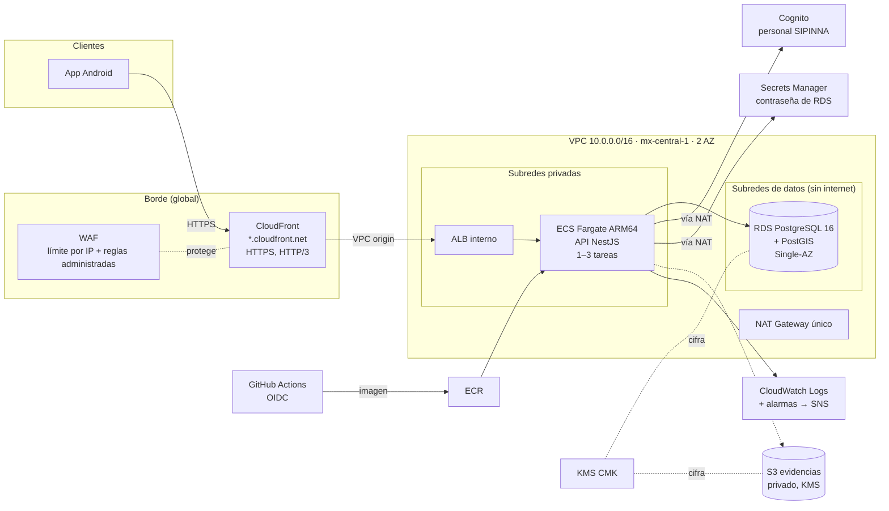

# Arquitectura en AWS

> Estado real al 10-oct-2026. Fuente: `infra/terraform/` y consultas de solo lectura a la cuenta (perfil `rieti`).
> `terraform plan` del 10-oct-2026: **sin diferencias** entre el código y lo desplegado.
> Este documento sustituye al borrador de la Etapa 2, que mencionaba Route 53 y ACM como planeados.

## Diagrama

## Servicios

| Capa | Recursos | Notas |
|---|---|---|
| Borde | CloudFront (certificado por defecto `*.cloudfront.net`, `https-only`, sin caché para el API, política de cabeceras de seguridad administrada) + AWS WAF | WAF: 300 solicitudes por IP cada 5 min; reglas de AWS: reputación de IP, Common, Known Bad Inputs, SQLi. El WAF de CloudFront vive en `us-east-1`. |
| Red | VPC con 2 AZ; subredes públicas (NAT), privadas (ALB y ECS) y de datos (RDS, sin ruta a internet); un NAT; endpoint de S3; VPC Flow Logs | El SG por defecto no tiene reglas. |
| Balanceo | ALB **interno**, sin IP pública | Solo lo alcanza CloudFront por *VPC origin*; SG limitado a la lista de prefijos de CloudFront. Logs de acceso a S3 (90 días). |
| Cómputo | ECS Fargate ARM64 (Graviton), 0.25 vCPU / 512 MB, autoescalado 1–3 tareas por CPU | Sistema de archivos de solo lectura, sin `exec`, circuit breaker con rollback. |
| Imágenes | ECR con tags inmutables y escaneo al subir | Conserva las últimas 15. |
| Datos | RDS PostgreSQL 16 `db.t4g.micro`, gp3 cifrado con CMK, `rds.force_ssl=1`, pgAudit (DDL, roles y escrituras, sin parámetros) | Protección contra borrado; snapshot final. Respaldos de 1 día. |
| Identidad | Cognito **personal**: alta solo por administrador, contraseñas ≥12 con complejidad, MFA TOTP **opcional**, grupos `Administrador` y `PersonalSIPINNA`, cliente público sin secreto | Sin dominio de Hosted UI configurado (verificado). |
| Identidad (ciudadanos) | Cognito **ciudadanos** (`rieti-prod-ciudadanos`, Fase 4): autorregistro con código por correo, contraseña ≥ 12, sin atributos extra, protección contra borrado, cliente público sin secreto con `prevent_user_existence_errors` y revocación de tokens | Correo con el remitente por defecto de Cognito (ver [Correo de Cognito y SES](#correo-de-cognito-y-ses)). |
| Secretos | Secrets Manager: contraseña maestra de RDS generada y rotada por AWS, cifrada con la CMK | La API la relee cada 5 min. |
| Almacenamiento | S3 de evidencias: privado, *Block Public Access*, KMS, versionado | Sin endpoint de subida todavía. |
| Operación | CloudWatch Logs (30 días, KMS), 5 alarmas (5xx del ALB, destinos sanos, CPU de ECS y RDS, almacenamiento de RDS), presupuesto mensual (150 USD) → SNS | Sin suscriptores hasta configurar `alerta_emails` (ver runbook). |
| CI/CD | Rol IAM para GitHub Actions por OIDC, limitado a `main` del repositorio | Sin llaves estáticas en GitHub. |
| Estado de Terraform | Bucket S3 cifrado y versionado con bloqueo nativo | Creado con `infra/bootstrap.sh`. |

## Desviaciones respecto al diseño (Etapa 1/2)

| Diseño | Realidad | Justificación / mitigación |
|---|---|---|
| ≥2 AZ con conmutación automática de la BD (RNF-12) | RDS Single-AZ, un NAT, 1 tarea mínima | D-04 (costo). Terraform permite activar `db_multi_az` y más tareas con una variable. |
| Respaldos diarios con retención de 30 días (RNF-13) | 1 día | D-02 (límite del plan gratuito). Variable `db_backup_dias`. Para cambios de riesgo se toma un snapshot manual (runbook). |
| API Gateway + WAF + CloudFront + Route 53 | CloudFront + WAF + ALB interno; sin Route 53 | D-03. El ALB queda protegido por *VPC origin* (no es alcanzable desde internet), que cumple el papel de la cabecera secreta del plan. |
| TLS 1.3 sin degradación (RNF-16) | Con el certificado `*.cloudfront.net` no se puede fijar la versión mínima de TLS | Requiere dominio propio + ACM. HSTS sí está activo (verificado con `curl -I`). |
| 2FA obligatorio (RNF-18) | MFA opcional; el login de la app no soporta el reto | D-06 (Hosted UI + PKCE) queda en la hoja de ruta. |
| RLS por municipio (RNF-19) | No existe; los reportes aún no guardan municipio | Planeado. El rol `rieti_app` (D-08) está preparado en `infra/sql/`. |
| Bitácora inmutable (RNF-21) | Trigger append-only en `seguimiento` + pgAudit | Implementado. |
| URLs prefirmadas ≤15 min (RNF-22) | Bucket y permisos listos, sin endpoint | Fuera del alcance de esta entrega. |
| Anónimo sin IP (RNF-29) | La BD no guarda IP. El WAF guarda muestras con IP por 3 h; los logs del ALB registran a CloudFront como cliente | Documentado como control parcial. |
| Redshift, QuickSight, OpenSearch, SES, Lambda | No desplegados (SES: ver la nota de correo) | Las estadísticas, cuando se hagan, saldrán de PostgreSQL/PostGIS. |
| Docker/Kubernetes | ECS Fargate | Contenedores gestionados equivalentes, sin administrar nodos. |
| Etiquetado del proyecto (D-09) | Etiquetas `Project=RIETI`, `Environment`, `ManagedBy=Terraform` | D-09 se corrigió el 9-oct-2026 para usar `Project=RIETI`, la etiqueta realmente desplegada. |

## Mapas y geocodificación (Fase 2)

| Opción | Estado | Notas |
|---|---|---|
| Amazon Location Service en `mx-central-1` | **No disponible** | Sus endpoints (`places.geo.mx-central-1…`, `maps.geo.mx-central-1…`) no existen (verificado el 14-oct-2026 con la CLI y DNS). Usarlo en `us-east-1` sacaría las coordenadas de la región de México. |
| OpenStreetMap (teselas y Nominatim) mediado por el backend | **En uso (demostración)** | Sin llaves. Cumple las políticas de uso (User-Agent con contacto, ≤ 1 req/s a Nominatim, caché, sin autocompletado por tecla). **No apto para tráfico de producción.** |
| Proveedor comercial con plan gratuito y llave (p. ej. MapTiler, Stadia, Geoapify) | Recomendado para producción | El backend ya está preparado: basta otra implementación de `FuenteGeo` y la llave en Secrets Manager. La app no cambia porque siempre habla con nuestro API. |

Las teselas pasan por CloudFront sin caché (política `CachingDisabled` del API) y el backend las guarda en memoria. Si el uso crece, conviene un comportamiento de CloudFront con caché para `/api/v1/geo/teselas/*` (cambio de infraestructura que requiere aprobación). El WAF limita a 300 peticiones por IP cada 5 minutos; osmdroid guarda teselas en la caché del teléfono, así que una sesión normal queda por debajo.

## WAF: límite por IP y el 403 "Request blocked" (Fase 5)

**Qué pasó.** La portada respondió `403 Request blocked` de CloudFront. El ID de solicitud ya no se puede buscar: el WAF no tiene logs y sus muestras solo duran 3 horas. Las métricas de CloudWatch de los últimos 15 días (consultadas el 18-oct-2026) muestran **un solo episodio de bloqueos: 33 peticiones el 15-oct-2026 entre las 18:00 y las 19:00 (hora de la Ciudad de México), todas por la regla `limite-por-ip`**. Las reglas administradas (reputación de IP, Common, Known Bad Inputs, SQLi) no bloquearon nada en ese periodo.

**Por qué.** `limite-por-ip` permite **300 peticiones por IP cada 5 minutos y cuenta todo**: la página, sus recursos, cada llamada al API y cada tesela del mapa. Ese día, desde la misma red se hicieron pruebas del emulador contra producción (el mapa pide decenas de teselas por vista); cualquier navegador de esa red quedó bloqueado hasta 5 minutos. Con varias personas detrás de la misma IP (la red de la escuela durante la demo) el límite se alcanza fácil.

**Propuesta (no aplicada; requiere aprobación).** `terraform plan`: **0 recursos nuevos, 1 cambio en el lugar (la web ACL), 0 destrucciones**.

| Regla | Hoy | Propuesta |
|---|---|---|
| `limite-por-ip` (todo) | 300 / 5 min | **2000 / 5 min** (`waf_limite_general`) |
| `limite-api-por-ip` (nueva: `/api/` sin teselas) | — | **600 / 5 min** (`waf_limite_api`) |

Las rutas sensibles conservan su límite propio en el API (5 reportes y 5 inicios de sesión por minuto por IP, bloqueo por folio en la consulta). **Ojo para la demo:** esos límites del API también son por IP; desde una sola red, el sexto reporte del mismo minuto recibe 429. Es intencional (ataque A9); si se prevé una demo con muchas personas reportando a la vez, conviene escalonar los envíos.

## Correo de Cognito y SES

El pool de ciudadanos envía los códigos de verificación y de recuperación con el **remitente por defecto de Cognito** (`COGNITO_DEFAULT`). Sirve para la demostración, pero:

- Tiene una **cuota diaria baja** (del orden de 50 correos al día por cuenta, según la documentación de AWS) y el remitente es `no-reply@verificationemail.com`, que algunos buzones filtran como spam.
- Si se agota la cuota, nadie puede activar su cuenta ni recuperar su contraseña ese día. El reporte anónimo **no se ve afectado**.

**Para producción** hace falta Amazon SES:

1. **SES no existe en `mx-central-1`** (verificado el 15-oct-2026: `aws sesv2 get-account --region mx-central-1` no encuentra el endpoint). Cognito permite usar una identidad de SES de otra región compatible; hay que confirmar en la documentación de Cognito qué regiones admite para un pool en `mx-central-1` antes de decidir.
2. Verificar una identidad (idealmente el dominio institucional con DKIM; un correo suelto solo para pruebas).
3. Pedir la **salida del sandbox** de SES (en `us-east-1` la cuenta está en sandbox: 200 correos/día y solo a destinatarios verificados; consultado el 15-oct-2026).
4. Cambiar `email_configuration` del pool a `DEVELOPER` con `source_arn` de la identidad (cambio en `infra/terraform/cognito_ciudadanos.tf` que no reemplaza el pool, pero conviene revisar el `plan`).

Los correos de Cognito salen de AWS hacia el buzón de la persona: su contenido solo es el código, sin datos del reporte.

## Costo

El plan del equipo estima ≈90–110 USD/mes (NAT, ALB, RDS, Fargate y WAF son los mayores). **No se verificó contra la facturación.** El presupuesto de AWS avisa al 80 % real y al 100 % pronosticado de 150 USD.

## Datos publicados en el repositorio

El repositorio es público. Desde el 14-oct-2026 el nombre del bucket de estado (que contiene el ID de la cuenta) va en `infra/terraform/backend.hcl`, ignorado por git (ataque A24); el historial anterior todavía lo conserva. No hay correos personales, llaves ni archivos de estado en el repositorio (verificado con `gitleaks` y búsqueda en los archivos versionados).
