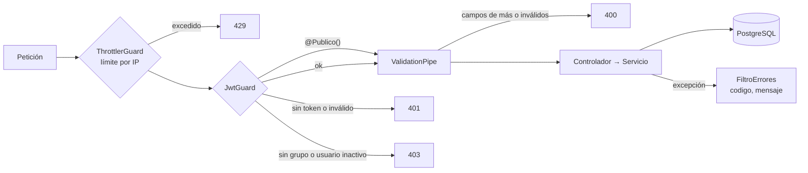

# Arquitectura del backend

> Estado al 10-oct-2026, rama `integracion-final`. Código en `backend/`.

## Plataforma

| Tema | Elección |
|---|---|
| Runtime | Node.js 24 LTS (≥ 24.7, por `crypto.argon2`) |
| Framework | NestJS 11 + Express |
| Datos | PostgreSQL 16 + PostGIS en Amazon RDS, con TypeORM 0.3 (migraciones, sin `synchronize`) |
| Validación | `class-validator` + `class-transformer` |
| Seguridad HTTP | `helmet`, `@nestjs/throttler` |
| Identidad | Amazon Cognito (`@aws-sdk/client-cognito-identity-provider`, `aws-jwt-verify`) |
| Secretos | AWS Secrets Manager (contraseña de RDS rotada por AWS) |
| Pruebas | Jest + ts-jest + Supertest |
| Empaquetado | Docker multietapa `node:24-alpine`, ARM64, usuario no root, `HEALTHCHECK` |

## Módulos

```
src/
├── main.ts                 Arranque
├── configurar-app.ts       Helmet, límite de cuerpo, prefijo /api/v1, ValidationPipe, filtro de errores
├── app.module.ts           TypeORM, throttler, guards globales
├── auth/                   Login con Cognito, guard JWT (deniega por defecto), roles
│   └── alcance.ts            Alcance territorial por municipio y bitácora de accesos (Fase 7)
├── expediente/             Catálogos del expediente y alertas de punto recurrente (Fase 7)
├── admin/                  Asignaciones, parámetros, dependencias y bitácora de accesos (Fase 7)
├── fotos/                  Fotos opcionales (Fase 8): almacén S3, validación por contenido y re-codificación
├── reportes/               Registro, consulta ciudadana, bandeja, estatus, bitácora
│   ├── estatus.ts            Máquina de estados de la Etapa 1
│   ├── clave-consulta.ts     Clave aleatoria + Argon2id
│   └── limitador-intentos.ts Bloqueo por folio
├── ciudadanos/              Cuentas opcionales de ciudadano (Fase 4): API mediado sobre Cognito
├── avisos/                 Aviso de privacidad vigente
├── catalogos/              Entidades y endpoint de catálogos
├── comun/filtro-errores.ts Formato único {codigo, mensaje, detalle?}
├── health/                 /health y /health/ready
├── config/                 TypeORM y contraseña desde Secrets Manager
├── database/migrations/    Esquema versionado
└── scripts/                borrar-reporte.ts, depurar-accesos.ts y limpiar-pruebas.ts (tareas únicas de ECS)
```

## Rutas

| Método | Ruta | Acceso | Caso de uso |
|---|---|---|---|
| GET | `/health`, `/health/ready` | Público (fuera del prefijo) | Sondas del ALB/ECS |
| GET | `/api/v1/avisos-privacidad/vigente` | Público | CU-02 |
| GET | `/api/v1/catalogos` | Público | Catálogos del formulario |
| GET | `/api/v1/catalogos/actividades` | Público | Selector de actividad ("Otro" al final) |
| GET | `/api/v1/estadisticas/distribuciones`, `/tiempos`, `/sin-atender`, `/mapa-calor` | Personal (`estadisticas.ver`) | Panel (solo agregados, con umbral) |
| GET | `/api/v1/reportes/exportar.csv` | Personal (`reportes.exportar`), 10/min | Exportación de la bandeja filtrada |
| GET | `/api/v1/geo/reversa?lat=&lng=` | Público, 30/min por IP | Dirección sugerida (OSM, mediada) y municipio del punto (INEGI) |
| GET | `/api/v1/geo/teselas/:z/:x/:y.png` | Público, 600/min por IP | Mapa del Estado de México (proxy con caché) |
| POST | `/api/v1/reportes` | Público, 5/min por IP; token de ciudadano opcional, solo con `vincularCuenta: true` | CU-04 |
| POST | `/api/v1/reportes/consulta` | Público, 10/min por IP + bloqueo por folio | CU-08 |
| POST | `/api/v1/auth/login` | Público, 5/min por IP | Login del personal |
| POST | `/api/v1/ciudadanos/registro`, `/confirmar`, `/reenviar-codigo`, `/login`, `/refresh`, `/olvide-contrasena`, `/restablecer-contrasena` | Público, 3–20/min por IP según la ruta | Cuenta opcional de ciudadano (D-19) |
| GET | `/api/v1/ciudadano/cuenta`, `/api/v1/ciudadano/reportes` | Ciudadano (token del pool de ciudadanos) | "Mi panel" |
| POST | `/api/v1/ciudadano/cuenta/contrasena`, `/api/v1/ciudadano/cuenta/cerrar-sesion` | Ciudadano | Configuración de la cuenta |
| DELETE | `/api/v1/ciudadano/cuenta` | Ciudadano, 3/min | Eliminar la cuenta (los reportes se conservan) |
| GET | `/api/v1/reportes` | Personal | CU-09 bandeja (filtros: `estatus`, `municipioId`, `actividad`, `desde`, `hasta`, `folio`, `sinAtenderDias`, `riesgo`, `pendientes`, `orden`) |
| GET | `/api/v1/reportes/:id` | Personal | CU-09 detalle (Fase 5: `fechaEstatusActual` y `tipo` de cada evento de la bitácora) |
| PATCH | `/api/v1/reportes/:id/estatus` | Personal | CU-09/CU-10 |
| POST | `/api/v1/reportes/:id/seguimientos` | Personal | Nota interna o acción realizada (`tipo: accion`, Fase 7) |
| PATCH | `/api/v1/reportes/:id/expediente` | Personal (`expediente.editar`), 30/min | Expediente (Fase 7) |
| GET | `/api/v1/reportes/:id/cercanos`, `/responsables` | Personal | Posibles duplicados y responsables (Fase 7) |
| POST/DELETE | `/api/v1/reportes/:id/duplicado` | Personal (`expediente.editar`), 30/min | Vincular o quitar duplicado (Fase 7) |
| GET | `/api/v1/catalogos/expediente` | Personal | Dependencias, modalidades, verificaciones (Fase 7) |
| GET | `/api/v1/estadisticas/embudo` | Personal (`estadisticas.ver`) | Embudo de atención (Fase 7) |
| GET/PATCH | `/api/v1/alertas`, `/api/v1/alertas/:id` | Personal (`alertas.ver`/`alertas.gestionar`) | Alertas de punto recurrente (Fase 7) |
| GET/PUT/POST/PATCH | `/api/v1/admin/personal`, `/personal/:id/municipios`, `/configuracion`, `/dependencias`, `/dependencias/:id`, `/accesos` | Administrador | Administración (Fase 7) |

| POST | `/api/v1/reportes/fotos/solicitud`, `/fotos/confirmar` | Público con folio + clave, 10/min | Fotos opcionales (Fase 8, D-42) |
| GET | `/api/v1/reportes/:id/fotos` | Personal (`reportes.ver`), 30/min | Fotos con URL prefirmada de 60 s (Fase 8) |
| GET | `/api/v1/estadisticas/territorio?nivel=region\|colonia\|punto` | Personal (`estadisticas.ver`) | Mapa territorial por niveles (Fase 9, D-43) |
| GET | `/api/v1/estadisticas/hallazgos` | Personal (`estadisticas.ver`) | Hallazgos automáticos (Fase 9, D-44) |
| GET | `/api/v1/estadisticas/base-regional.csv` | Coordinación y administración (`base.exportar`), 5/min | Base regional anonimizada (Fase 9, D-45) |
| POST | `/api/v1/reportes/institucional` | Personal (`reportes.registrar`), 20/min | Registro institucional (Fase 9, D-46) |

Todas las estadísticas aceptan los filtros comunes de la Fase 9: `rangoEdad`, `riesgo`, `franja`, `dependenciaId`, `verificacion`, `reincidente` y `origen`, además de los anteriores.

Todas las rutas del personal se limitan al **alcance territorial** de quien consulta (D-36): fuera de él, 404 uniforme.

Contrato completo: [docs/api/openapi.json](../api/openapi.json). Se retiraron `GET /reportes/folio/:folio` (permitía enumerar reportes) y `PATCH /reportes/:id`.

## Flujo de una petición



## Modelo de datos

Basado en el ER de la Etapa 2. Tablas: `municipio`, `rol_usuario`, `actividad`, `riesgo`, `rango_edad`, `estatus_reporte` (catálogos); `usuario` (personal, vinculado a Cognito por `cognito_sub`, sin contraseñas); `ubicacion` (lat/lng + columna generada `punto geography(Point,4326)` con índice GiST); `reporte`; `folio` + `folio_contador` (consecutivo anual atómico); `caso` y `reporte_caso`; `seguimiento` (bitácora solo de inserción, protegida por trigger).

Fase 2: `reporte_menores_grupo` (menores por grupo de edad, tabla hija con llave `(id_reporte, id_rango_edad)`), `reporte.actividad_otro`, columnas de dirección en `ubicacion` (`calle`, `numero_exterior`, `colonia`, `codigo_postal`, `referencias`), `municipio_geom` (polígonos del INEGI, GiST) y `codigo_postal_municipio` (vacía; ver "Geografía").

Migraciones:
1. `1760000000000-EsquemaInicial`: esquema, PostGIS, pgAudit (si está precargado), trigger de la bitácora y catálogos.
2. `1760100000000-ClaveConsultaYEstatus`: `reporte.clave_consulta_hash`, `reporte.aviso_privacidad_version`, `caso.motivo_descarte` y catálogo de estatus canónico (renombra Atendido → En atención y Cerrado → Concluido, agrega Descartado). Al renombrar en vez de borrar, las referencias de la bitácora se conservan.

3. `1760200000000-MunicipiosYRed`: 125 municipios y directorio de la red (D-16, D-17).
4. `1760300000000-FormularioYGeografia` (Fase 2): actividades ampliadas con `orden`, rango "Sin determinar", grupos de edad (con relleno de los reportes existentes), dirección, `actividad_otro`, polígonos municipales y tabla de CP. Aditiva, idempotente y con `down`; probada sobre una base con datos (`test/e2e/migracion-formulario.e2e.spec.ts`).

### Formato de `POST /reportes`

El API acepta dos formatos, porque hay APK instaladas:

| Formato | Campos | Qué hace el servidor |
|---|---|---|
| Anterior | `ubicacion`, `cantidadNinos`, `edadAproximada` | Un solo grupo de edad; sin dirección estructurada |
| Nuevo (Fase 2) | `direccion`, `grupos`, `actividadOtro` | Deriva `ubicacion` (texto), `cantidad_ninos` (suma) y `id_rango_edad` (grupo mayor; en empate, el más pequeño) |

**Por qué tabla hija y no JSONB para los grupos:** integridad referencial con `rango_edad`, `CHECK` en la base, sin rangos repetidos por la llave primaria, y agregados directos en SQL para las estadísticas de la Fase 3.

### Geografía

- **Validación del punto:** si llegan `latitud` y `longitud`, deben caer dentro del municipio elegido o a menos de 300 m de su límite (`ST_DWithin` sobre `municipio_geom`); si no, `400 UBICACION_FUERA_DEL_MUNICIPIO` con el municipio donde sí cae. Las coordenadas se guardan redondeadas a 5 decimales (≈ 1 m).
- **Polígonos:** INEGI, Marco Geoestadístico (dic-2025), simplificados a ≈ 20 m con `scripts/generar-geom-municipios.mjs` (reproducible).
- **Código postal:** siempre se exige que sea del Estado de México (50000–57999, rango exclusivo del estado). El cruce CP–municipio solo se activa si un operador carga `codigo_postal_municipio` con `scripts/cargar-codigos-postales.ts`: el catálogo de SEPOMEX no permite su distribución, así que no se versiona.
- **Geocodificación inversa y teselas mediadas:** la app y la web nunca llaman a terceros. El servidor consulta Nominatim (OSM) con coordenadas redondeadas a ≈ 11 m, con `User-Agent` identificable, máximo 1 petición por segundo por tarea y caché de 7 días; las teselas se sirven desde una caché en memoria (24 h), solo del Estado de México y con zoom 8–18. La fuente externa está detrás de la interfaz `FuenteGeo`, que las pruebas sustituyen por un doble.

Las migraciones corren al arrancar (`migrationsRun`). Con un usuario sin permisos de DDL (`rieti_app`, D-08) se desactivan con `DB_MIGRAR_AL_INICIAR=false` y se corren aparte con el usuario maestro.

### Fase 6: campos del reporte y canales

| Campo | Valores | Quién lo pone |
|---|---|---|
| `peligro_inmediato` | `Sí`, `No`, `No sé` (null en reportes anteriores) | Ciudadano (opcional para clientes anteriores) |
| `prioridad` | `Alta`, `Media`, `Normal` | Servidor (`calcularPrioridad`) |
| `cantidad_categoria` | `1`–`4`, `5+`, `No sé` | Ciudadano (se valida contra los grupos) o derivada |
| `canal` | `app`, `web`, `institucional`, `whatsapp` (reservado) | Cliente público: `app`/`web`; el resto, el servidor |
| `origen` | `ciudadano`, `institucional` | Servidor |
| `municipio.clave_folio` | 3 letras, única | Catálogo (provisional salvo ATZ, NAU, TLA, CIZ) |

**WhatsApp (propuesta, no implementada; D-34).** Una entrada por WhatsApp Business API (Cloud API de Meta) llegaría a un webhook propio (`POST /api/v1/canales/whatsapp`, verificado con la firma de Meta), que conversaría con la persona con las mismas preguntas del formulario, guardaría el estado de la conversación solo en memoria con caducidad corta y, al final, llamaría al mismo servicio `ReportesService.crear` con `canal = whatsapp`. El número de teléfono **no** se guardaría con el reporte (minimización); el folio y la clave se responderían en el mismo chat. Requisitos: cuenta de WhatsApp Business verificada, plantilla de mensajes aprobada, costos por conversación y una revisión de privacidad, porque Meta procesa los mensajes.

### Fase 7: expediente y control territorial

| Tabla / columna | Qué guarda |
|---|---|
| `asignacion_municipio` | Municipios de cada enlace municipal (PK usuario + municipio) |
| `caso.id_responsable`, `id_dependencia`, `fecha_seguimiento`, `resultado`, `fecha_cierre`, `id_modalidad`, `verificacion`, `nna_*` | Expediente interno (D-37) |
| `dependencia`, `modalidad` | Catálogos del expediente (dependencias editables por el Administrador) |
| `seguimiento.tipo` | `nota`, `accion` o `expediente` (null en eventos anteriores) |
| `reporte.duplicado_de` | Principal del posible duplicado (D-38) |
| `configuracion` | Parámetros de duplicados, alertas y conservación |
| `alerta_territorial` | Alertas de punto recurrente (centro con 5 decimales, conteo, estatus) |
| `acceso_expediente` | Bitácora de accesos, append-only (D-40) |
| `foto_reporte` (Fase 8) | Referencia al objeto en S3 (`fotos/<uuid>.jpg`), bytes, dimensiones y SHA-256 de la imagen re-codificada (D-42) |

**Fotos (Fase 8).** Cliente → `POST /reportes/fotos/solicitud` (folio + clave) → POST prefirmado directo a `s3://…/entrantes/<reporte>/<uuid>` (no pasa por CloudFront ni el WAF) → `POST /reportes/fotos/confirmar` → el API lee el objeto por el endpoint de VPC de S3, valida, re-codifica con `sharp` y escribe `fotos/<uuid>.jpg`. `sharp` se carga al usarse; CI comprueba que funciona dentro de la imagen ARM64.

## Máquina de estados

| Desde (interno → etiqueta pública) | Hacia |
|---|---|
| Recibido → **Registrado** | En revisión, Descartado |
| En revisión | En atención, Canalizado, Descartado |
| En atención → **En seguimiento** | Canalizado, Concluido |
| Canalizado | En atención, Concluido |
| Concluido | Archivado, Reincidente (exige comentario) |
| Reincidente | En revisión, En atención |
| Archivado | — (terminal) |
| Descartado → **Cancelado** | — (terminal; exige motivo) |

`estatus.ts` es la única fuente de verdad. El detalle del reporte incluye `transicionesPermitidas` para que los clientes no dupliquen la regla.

## Configuración (variables de entorno)

| Variable | Uso |
|---|---|
| `PORT` | Puerto HTTP (3000) |
| `DB_HOST`, `DB_PORT`, `DB_NAME`, `DB_USERNAME` | Conexión a PostgreSQL |
| `DB_SECRET_ARN` / `DB_PASSWORD` | Contraseña desde Secrets Manager (AWS) o directa (local) |
| `DB_SSL`, `DB_SSL_CA` | TLS a RDS (`false` solo en local) |
| `DB_MIGRAR_AL_INICIAR` | `false` para no correr migraciones al arrancar |
| `COGNITO_USER_POOL_ID`, `COGNITO_CLIENT_ID` | Validación de JWT y login del personal |
| `COGNITO_CIUDADANOS_POOL_ID`, `COGNITO_CIUDADANOS_CLIENT_ID` | Pool y cliente de las cuentas de ciudadano (los inyecta el workflow desde variables del repositorio) |
| `TRUST_PROXY_HOPS` | Saltos de proxy (CloudFront → ALB = 2) para obtener la IP del límite de tasa |
| `CORS_ORIGINS` | Orígenes web permitidos (vacío: sin CORS) |
| `ESTADISTICAS_UMBRAL` | Conteo mínimo de una celda de las estadísticas (3) |
| `ESTADISTICAS_MIN_CASOS_TIEMPO` | Casos mínimos para publicar un tiempo de proceso (5; nunca menos que el umbral). Con menos: "datos insuficientes" |

## Pruebas

```bash
cd backend
npm ci && npm run build
npm test                                   # unitarias (45)
E2E_DB_PORT=5432 E2E_DB_PASSWORD=... npm run test:e2e        # e2e contra PostgreSQL + PostGIS
E2E_COMO_RIETI_APP=1 E2E_DB_PORT=5432 ... npm run test:e2e   # e2e conectado como rieti_app
```

Las e2e crean la base `rieti_e2e`, corren las migraciones reales y prueban las rutas con el guard real; solo el verificador de JWT de Cognito se sustituye por un doble (inyectado con el token `VERIFICADOR_JWT`). En CI corren con el contenedor `postgis/postgis:16-3.4` en ambos modos.

## Despliegue

`.github/workflows/backend.yml`: en cada push a `main` que toque `backend/`, corre pruebas unitarias y e2e, construye la imagen ARM64, la sube a ECR (tag = SHA del commit, inmutable), registra una nueva revisión de la task definition y actualiza el servicio ECS (con rollback automático). La autenticación con AWS es por OIDC. Al arrancar, la tarea nueva aplica las migraciones pendientes.
