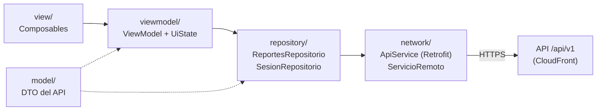

# Arquitectura de la app Android

> Estado al 10-oct-2026, rama `integracion-final`. Código en `app/`.

## Plataforma y librerías

| Tema | Elección |
|---|---|
| Lenguaje | Kotlin 1.9.24 |
| UI | Jetpack Compose (BOM 2024.06.00, compiler extension 1.5.14) + Material 3 |
| Arquitectura | MVVM: `ViewModel` + `StateFlow` + `UiState` sellado |
| Navegación | Navigation Compose (una sola Activity) |
| Red | Retrofit 2.9 + Gson + OkHttp 4.12 (logging solo en debug y sin cuerpos) |
| Ubicación | Google Play Services Location 21.3 (lectura única bajo demanda) |
| Pruebas | JUnit 4 en la JVM |
| Build | AGP 8.13.2, Gradle 8.13, minSdk 26, compile/targetSdk 34, JDK 17 o 21 (no 25) |

No se usan inyección de dependencias (Hilt/Koin) ni Room: los repositorios reciben el `ApiService` por constructor con un valor por defecto, lo que basta para sustituirlo en pruebas.

## Capas



- **view/**: funciones `@Composable` sin lógica de negocio. Leen `StateFlow` con `collectAsState()` y llaman métodos del ViewModel.
- **viewmodel/**: estado de cada pantalla como `UiState` (`Inactivo`, `Cargando`, `Exito`, `Error`). La validación del formulario vive en `ValidadorReporte`, que es lógica pura y tiene pruebas.
- **repository/**: único lugar donde se llama a Retrofit. `ejecutar { }` convierte cualquier excepción en `Resultado.Error(codigo, mensaje)` usando el formato de error del API.
- **network/**: contrato Retrofit (`ApiService`) y cliente HTTP (`ServicioRemoto`), que agrega `Authorization: Bearer` cuando hay sesión.
- **model/**: clases de datos que reflejan el JSON del API ([docs/api/openapi.json](../api/openapi.json)).

## Pantallas y navegación

```mermaid
flowchart TD
    I[Inicio] -->|Reportar una situación| A[Aviso de privacidad]
    A -->|Acepto| F[Formulario]
    F -->|Enviar| C[Confirmación<br/>folio + clave]
    C -->|Volver al inicio| I
    I -->|Consultar mi reporte| Q[Consulta<br/>folio + clave]
    I -->|Soy personal SIPINNA| L[Login]
    L --> P[Inicio del personal]
    P -->|tarjeta o "Ver todos"| B[Bandeja]
    B --> D[Detalle y seguimiento]
    B -->|Salir| I
    I -->|Iniciar sesión o crear cuenta - opcional| K[Mi cuenta<br/>entrar / crear / activar / recuperar]
    K --> M[Mi panel]
    I -->|Mi panel, con sesión| M
    M -->|Cuenta| G[Configuración de cuenta]
```

| Pantalla | Archivo | Qué hace |
|---|---|---|
| Inicio | `InicioScreen.kt` | Logo centrado, una pregunta y las dos acciones principales (Reportar / Consultar) grandes; recordatorio del 911; bloques "Qué es SIPINNA", "Cómo funciona un reporte" (4 pasos) y "Tu privacidad"; acceso discreto del personal y pie institucional. Botón discreto "Iniciar sesión o crear cuenta (opcional)", que con sesión cambia a "Mi panel" (D-19). |
| Aviso de privacidad | `AvisoPrivacidadScreen.kt` | Descarga el aviso vigente del API y lo muestra por secciones con título; la casilla y "Continuar" quedan fijos abajo. Si el servidor no envía secciones, muestra los párrafos. |
| Formulario | `FormularioReporteScreen.kt` | **Dónde:** municipio con búsqueda, mapa OSM (`MapaUbicacion.kt`, osmdroid) con marcador que se toca o arrastra, "Usar mi ubicación" (permiso opcional) y dirección editable (calle, número, colonia, CP, referencias) que se autorrellena desde el mapa sin borrar lo escrito; si el punto cae en otro municipio, se ofrece cambiarlo. **Menores por grupo de edad** con contadores (`ContadorEdades`, total ≤ 50). **Actividad** desplegable (`SelectorActividad`, catálogo del servidor con respaldo local) y "Otro" con detalle. Riesgo y descripción. Con sesión de ciudadano aparece el interruptor **"Vincular este reporte a mi cuenta", apagado por defecto**; sin sesión no aparece. |
| Confirmación | `ConfirmacionScreen.kt` | Tarjeta de éxito, aviso "guarda esto", folio y clave en tarjetas separadas (monoespaciada), botones Copiar folio / Copiar clave / Copiar ambos / Compartir. El portapapeles recibe solo el valor limpio, marcado como sensible. |
| Consulta | `ConsultaScreen.kt` | Folio + clave → estatus e historial público. Interpreta lo pegado con `ExtractorFolioClave` (bloque completo en cualquier campo, minúsculas, espacios, sin guiones) y tiene botón "Pegar". |
| Mi cuenta | `CuentaScreens.kt` (`AccesoCuentaScreen`) | Pestañas Iniciar sesión / Crear cuenta; activar con el código de 6 dígitos (y reenviarlo); "Olvidé mi contraseña" con código. Los mensajes son los del servidor, que no revelan si un correo tiene cuenta. |
| Mi panel | `CuentaScreens.kt` (`MiPanelScreen`) | Reportes vinculados con estatus e historial público; deslizar para actualizar. |
| Configuración de cuenta | `CuentaScreens.kt` (`ConfiguracionCuentaScreen`) | Datos de la cuenta, cambiar contraseña, cerrar sesión en todos los dispositivos y eliminar la cuenta (con diálogo de confirmación). |
| Login | `LoginScreen.kt` | Correo y contraseña (oculta) del personal. |
| Inicio del personal | `InicioPersonalScreen.kt` | Tarjetas grandes de pendientes y casos sin cambios en más de 7 días, cuadrícula por estatus (cada tarjeta abre la bandeja filtrada), deslizar para actualizar. Sin mapa ni gráficas complejas. |
| Bandeja | `BandejaScreen.kt` | Reportes del más reciente al más antiguo, filtro por estatus o "sin atender" (desde el inicio), cerrar sesión. |
| Detalle | `DetalleReporteScreen.kt` | Datos del reporte, cambio de estatus (solo opciones válidas que manda el servidor), notas y bitácora. |

El grafo vive en `view/MainActivity.kt` y las rutas en `view/Rutas.kt`. Si el servidor responde `NO_AUTENTICADO` en la bandeja o el detalle, la app descarta el token y regresa al login.

## Seguridad en el dispositivo

- **Sin texto claro en release.** `usesCleartextTraffic="false"`; el build debug permite HTTP solo hacia `10.0.2.2` (`src/debug/res/xml/network_security_config.xml`).
- **Token del personal solo en memoria.** No se escribe en disco; al cerrar la app hay que volver a iniciar sesión.
- **Sesión de ciudadano (Fase 4).** El refresh token se guarda cifrado con AES-GCM y una llave del Android Keystore (`AlmacenSeguro.kt`), que no se puede extraer del equipo; el access token vive solo en memoria. El token de ciudadano se manda únicamente en las rutas `/ciudadano/*` y en un reporte cuando la persona activa "Vincular".
- **Sin respaldos.** `allowBackup="false"` y `data_extraction_rules.xml` excluye todo de la nube y de la transferencia entre dispositivos.
- **`FLAG_SECURE` en release.** Impide capturas de pantalla y la vista previa en "recientes". En debug está desactivado para poder documentar con capturas.
- **Minimización.** La app no envía identificadores del dispositivo. La ubicación del teléfono solo se usa si la persona toca "Estoy en el lugar", y se envía como ubicación del lugar de los hechos.
- **Sin terceros.** Se eliminó la miniatura de mapa de un servicio público, que enviaba las coordenadas del reporte fuera del sistema.
- **Portapapeles sensible.** El folio y la clave se copian con `EXTRA_IS_SENSITIVE`: en Android 13+ el sistema no muestra su vista previa.

## Identidad visual

- Los logos se recortan a su marca legible (figuras + "RIETI"; palabra "SIPINNA" con su ícono). El texto pequeño de los originales ("Ruta Intermunicipal…", "Sistema Municipal de Protección Integral…") no se lee a tamaño de pantalla, así que se muestra como texto real: nítido, accesible y escalable con la fuente del sistema.
- Hay un PNG por densidad (`drawable-mdpi` a `drawable-xxxhdpi`) remuestreado con Lanczos desde `assets/logos/`. En xxxhdpi el logo de RIETI queda limitado por la resolución del original (494 px); con un original vectorial se podría generar un VectorDrawable.
- Botones principales de 56 dp, objetivos táctiles de al menos 48 dp, encabezados marcados para lectores de pantalla y colores con contraste AA. El tema es solo claro (los logos se diseñaron para fondo claro).

## Mapa (Fase 2)

- **osmdroid 6.1.20**: Java puro, sin servicios de Google ni bibliotecas nativas (< 1 MB). Se descartó MapLibre Native por tamaño (≈ 15 MB de bibliotecas nativas) y porque necesita teselas vectoriales y un estilo.
- Las teselas vienen de `api/v1/geo/teselas/` (nuestro backend), con caché en `cacheDir` (sin permisos de almacenamiento). La atribución "© colaboradores de OpenStreetMap" es visible bajo el mapa.
- El mapa no es accesible para lectores de pantalla; por eso la dirección siempre se puede escribir a mano y el punto es opcional.

## Configuración

`BuildConfig.API_URL` se define en `app/build.gradle.kts` (por defecto la URL de CloudFront). Para usar un backend local en el emulador:

```bash
./gradlew assembleDebug -Prieti.apiUrl=http://10.0.2.2:3000/
```

## Pruebas y calidad

```bash
./gradlew assembleDebug testDebugUnitTest lintDebug
```

- `ValidadorReporteTest`: reglas del formulario, catálogos y normalización del folio.
- `ExtractorFolioClaveTest`: 19 casos de texto pegado (bloque combinado, etiquetas, minúsculas, espacios, sin guiones, saltos de línea, guiones largos, basura, palabras que parecen clave).
- `ErroresApiTest`: traducción de `{codigo, mensaje}`, incluida la diferencia entre "credenciales incorrectas" y "sesión expirada".
- Lint: 0 errores (las 15 advertencias son de versiones de dependencias; no se actualizan sin decisión del equipo).
- CI: `.github/workflows/android.yml`.

## Limitaciones conocidas

- La app no se ha probado en esta rama contra el API desplegado: el API nuevo se despliega al fusionar el PR. El guion de prueba está en [PRUEBA-APP](../PRUEBA-APP.md).
- La bandeja muestra solo la primera página (50 reportes) y el total.
- No hay MFA ni Hosted UI (D-06): el personal usa contraseña permanente.
- No hay modo sin conexión, evidencias fotográficas ni R8.
